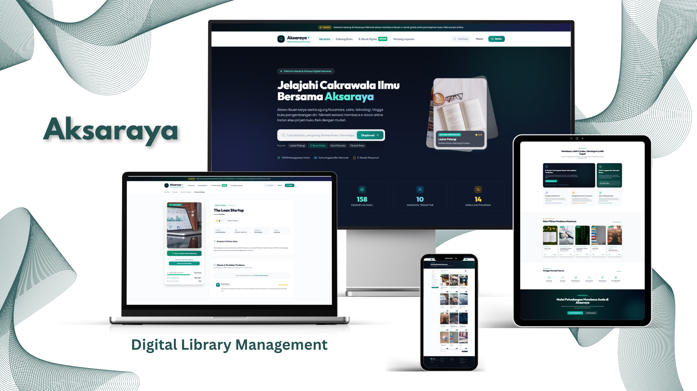

# Aksaraya - Digital Library Management

[](#)
[](#)
[](#)
[](#)
[](#)
[](#)
[](#)
[](./LICENSE)



Aksaraya (*Perpustakaan Digital Nusantara Modern & Terpadu*) is a comprehensive, full-stack digital library management and e-reading platform built with Laravel 13, Tailwind CSS v4, and Alpine.js. Designed to bridge physical book circulation with seamless digital reading, Aksaraya replaces cumbersome paper-based borrowing logs with an automated circulation desk, instant catalog discovery, in-browser e-book reading, and real-time administrative telemetry.

Traditional municipal and academic libraries frequently suffer from siloed book records, slow manual checkouts, human error in overdue fine calculations, and a complete disconnect between physical shelves and digital reading materials. Aksaraya addresses these bottlenecks with an integrated multi-role ecosystem serving readers (*Anggota*), circulation librarians (*Petugas*), and library directors (*Admin*). Members can discover collections, track personal reading progress, curate custom bookshelves, reserve loans, and read e-books directly on any device. Simultaneously, library staff execute fast walk-in loans using barcode scanning, process returns with automated daily fine computations, dispatch multi-channel circulation notifications, and generate print-ready audit reports.

---

## Features

- **Multi-Faceted Catalog & Real-Time Discovery**: Instant search across titles, authors, publishers, and ISBN codes with dynamic filters for categories, formats (Digital E-Book vs. Physical Hardcover), and real-time inventory availability.
- **Embedded In-Browser E-Book Reader**: Integrated distraction-free digital e-reader supporting full-screen viewing, dynamic page navigation, and automatic progress tracking synchronized with member profiles.
- **Member Self-Service & Digital Identity**: Personalized reader portal featuring digital member cards with scannable barcodes, active loan tracking, personal bookshelf organization (*Want to Read*, *Currently Reading*, *Completed*), annual reading challenges, bookmarking, and community ratings/reviews.
- **End-to-End Circulation Lifecycle**: Automated state management across the full loan lifecycle (`Pending Request` &rarr; `Approved / Ready for Pickup` &rarr; `Borrowed` &rarr; `Returned` / `Overdue` / `Rejected`) with strict borrowing limits, active loan constraints, and automated inventory counter synchronization.
- **Front-Desk Walk-In Circulation with Barcode Lookup**: Fast checkout terminal for library officers enabling instant member and book resolution through real-time barcode query endpoints.
- **Automated Multi-Channel Circulation Alerts**: Built-in notification service generating dispatch-ready WhatsApp and email communications for loan approvals, impending due dates, and overdue fine notices.
- **Catalog Management & CSV Batch Ingestion**: Full administrative catalog CRUD supporting book cover uploads, PDF e-book attachments, shelf location tagging, featured status toggling, and bulk data exchange via CSV export and import.
- **Circulation & Financial Telemetry**: Date-filtered operational reporting analyzing loan volumes, return compliance rates, accumulated overdue fines, and realized fee collections, complete with printable official audit sheets.
- **Role-Based Access Control & System Configuration**: Three distinct security roles (`admin`, `petugas`, and `anggota`) backed by dynamic policy settings allowing administrators to configure loan periods, daily fine rates, and maximum concurrent loan allowances without modifying application code.

---

## Preview & Demo

The application user interface is demonstrated across member and administrative workflows:


*Member Experience & Self-Service Portal: Real-time Member Dashboard with annual reading challenge tracking and shelf status breakdown (top-left); official Digital Member Card with scannable barcode and identification metadata (top-right); self-service circulation history with loan filter tabs and status chips (bottom-left); and comprehensive member profile settings (bottom-right).*


*Administrative Control Center & Circulation Ops: Central administrative command dashboard with operational KPI cards, recent circulation streams, and popular book rankings (top-left); circulation desk overview with status filters and direct checkout tools (top-right); category taxonomy and shelf classification cards (bottom-left); and circulation & financial audit reporting with print-ready ledger generation (bottom-right).*

---

## Tech Stack

### Core Architecture
- **Language**: PHP 8.3+
- **Backend Framework**: Laravel 13.x
- **Database & ORM**: SQLite (default zero-config database) / Eloquent ORM
- **Frontend Template Engine**: Laravel Blade
- **Styling & Design System**: Tailwind CSS v4.0 (modern emerald teal and deep navy luxury palette)
- **Client-Side Reactivity**: Alpine.js v3.x
- **Iconography**: Lucide Icons
- **Typography**: Plus Jakarta Sans & Outfit (Google Fonts)

### Tooling & Infrastructure
- **Asset Bundler**: Vite 8.x with `@tailwindcss/vite`
- **Package Managers**: Composer (PHP) & npm (Node.js)
- **Testing Framework**: PHPUnit 12.x
- **Code Quality**: Laravel Pint

---

## Prerequisites

Before setting up the project locally, ensure the following runtimes and tools are installed:

- **PHP**: Version 8.3 or higher (with required extensions: `pdo_sqlite`, `mbstring`, `openssl`, `tokenizer`, `xml`, `ctype`, `json`, `bcmath`, `fileinfo`)
- **Composer**: Version 2.2 or higher
- **Node.js & npm**: Node.js 18.x or higher with npm 9.x+
- **SQLite3**: Enabled by default in PHP 8.3 distributions

---

## Installation & Setup

1. **Clone the repository:**
   ```bash
   git clone https://github.com/weztcy/Aksaraya---Digital-Library-Management.git
   cd "Aksaraya---Digital-Library-Management"
   ```

2. **Install PHP dependencies:**
   ```bash
   composer install
   ```

3. **Install frontend dependencies:**
   ```bash
   npm install
   ```

4. **Prepare the environment configuration:**
   ```bash
   copy .env.example .env
   # On macOS or Linux: cp .env.example .env
   ```

5. **Generate the application encryption key:**
   ```bash
   php artisan key:generate
   ```

6. **Initialize the SQLite database and seed initial data:**
   ```bash
   # Create the SQLite database file if not already present
   # Windows PowerShell:
   New-Item -ItemType File -Path database/database.sqlite -Force

   # Linux/macOS:
   # touch database/database.sqlite

   php artisan migrate --seed
   ```

7. *(Optional)* **Seed the extended comprehensive book collection:**
   ```bash
   php artisan db:seed --class=ComprehensiveLibrarySeeder
   ```

8. **Create public storage symbolic link (for book covers and e-books):**
   ```bash
   php artisan storage:link
   ```

9. **Build frontend assets for production:**
   ```bash
   npm run build
   ```

---

## Environment Variables

Key configurable variables defined in `.env.example`:

| Variable | Description | Safe Example Value | Required |
| :--- | :--- | :--- | :--- |
| `APP_NAME` | The title and display brand of the application | `"Aksaraya"` | Yes |
| `APP_ENV` | Application environment lifecycle state | `local` | Yes |
| `APP_KEY` | 32-character AES symmetric encryption key | `base64:...` *(via `artisan key:generate`)* | Yes |
| `APP_DEBUG` | Detailed debug error reporting toggle | `true` | Yes |
| `APP_URL` | Root URL for local development | `http://localhost:8000` | Yes |
| `DB_CONNECTION` | Database driver | `sqlite` | Yes |
| `DB_DATABASE` | SQLite database file location | `database/database.sqlite` | Yes |
| `SESSION_DRIVER` | Session storage engine | `database` | Yes |
| `QUEUE_CONNECTION` | Background job queue driver | `database` | Yes |
| `CACHE_STORE` | Cache management store | `database` | Yes |
| `FILESYSTEM_DISK` | Storage driver for covers and documents | `local` | Yes |
| `MAIL_MAILER` | Mail service driver for alerts | `log` | Optional |

---

## Usage / Running the Project

### Starting Local Development Servers

1. **Start the Laravel backend development server:**
   ```bash
   php artisan serve
   ```
   The application will be live at `http://localhost:8000`.

2. **Start the Vite asset server for instant hot module reloading:**
   ```bash
   npm run dev
   ```

3. **Or run both servers simultaneously using Composer:**
   ```bash
   composer run dev
   ```

### Default Seeded Demonstration Accounts

The database seeders populate representative accounts across all three user roles:

| Role | Email Address | Password | Permissions & Workflow Scope |
| :--- | :--- | :--- | :--- |
| **Administrator** | `admin@aksaraya.id` | `password` | Complete access: executive KPI dashboard, book inventory CRUD with CSV data exchange, category taxonomy, member administration, financial reports, and global operational settings. |
| **Library Staff (*Petugas*)** | `petugas@aksaraya.id` | `password` | Front-desk operations: on-desk walk-in loans, barcode scanning, book handover approvals, return confirmations with fine calculations, and reminder alerts. |
| **Member (*Anggota*)** | `budi@gmail.com` | `password` | Public & member portal: online catalog search, interactive e-reader, loan reservations, personal bookshelf management, reading challenge, and digital barcode card. |
| **Member (*Anggota*)** | `siti@gmail.com` | `password` | Additional member profile with active borrowings. |
| **Member (*Anggota*)** | `dimas@gmail.com` | `password` | Additional member profile with historical borrowings. |

---

## Available Scripts / Commands

Key automation commands available in `composer.json` and `package.json`:

| Command | Provider | Description |
| :--- | :--- | :--- |
| `composer run setup` | Composer | Executes full bootstrap pipeline: dependencies, environment, encryption key, database migrations, and frontend build. |
| `composer run dev` | Composer | Concurrently boots the PHP development server and background tasks. |
| `composer run test` | Composer | Clears configuration caches and runs the full PHPUnit test suite. |
| `npm run dev` | npm / Vite | Launches Vite live asset watcher with Hot Module Replacement (HMR). |
| `npm run build` | npm / Vite | Compiles and minifies CSS and JavaScript bundles for production. |
| `php artisan migrate:fresh --seed` | Artisan | Completely resets the database schema and runs all seeders. |
| `php artisan storage:link` | Artisan | Connects public web access to the private file storage directory. |

---

## API & Endpoints Reference

Aksaraya utilizes server-rendered Blade routes augmented with authenticated JSON and AJAX operational endpoints:

### Public & Member Interactive Endpoints
- `GET /` &mdash; Public homepage with curated book highlights, top categories, and system statistics.
- `GET /katalog` &mdash; Full book catalog with multi-criteria filtering (`q`, `kategori`, `tipe`, `ketersediaan`, `urutan`).
- `GET /katalog/{slug}` &mdash; Detailed book metadata, real-time availability status, and community reviews.
- `GET /katalog/{slug}/baca` &mdash; In-browser digital e-book reader view.
- `POST /katalog/{id}/favorit` &mdash; Toggle bookmark state (*Auth required*).
- `POST /katalog/{id}/ulasan` &mdash; Submit star rating (1&ndash;5) and textual book review (*Auth required*).
- `POST /katalog/{id}/progress` &mdash; Sync e-book reading progress via JSON payload `{ "last_page": 24, "total_pages": 120, "is_completed": false }` (*Auth required*).
- `POST /anggota/pinjam` &mdash; Submit physical book borrowing reservation request (*Member required*).
- `POST /anggota/rak-buku/{bookId}` &mdash; Update book shelf classification (*want_to_read*, *currently_reading*, *already_read*).

### Administrative & Circulation Endpoints
- `GET /admin/dashboard` &mdash; Administrative KPI metrics and recent circulation activities (*Admin & Staff*).
- `GET /admin/peminjaman/scan-barcode` &mdash; AJAX barcode scanner lookup for members or books (*Admin & Staff*).
- `POST /admin/peminjaman/{id}/setujui` &mdash; Approve pending member loan request (*Admin & Staff*).
- `POST /admin/peminjaman/{id}/serahkan` &mdash; Dispatch book handover to borrower (*Admin & Staff*).
- `POST /admin/peminjaman/{id}/kembalikan` &mdash; Process return, calculate overdue fines, and increment available stock (*Admin & Staff*).
- `POST /admin/peminjaman/{id}/bayar-denda` &mdash; Record fine settlement (*Admin & Staff*).
- `POST /admin/peminjaman/{id}/ingatkan` &mdash; Dispatch simulated WhatsApp/email due date reminder (*Admin & Staff*).
- `GET /admin/books/export/csv` &mdash; Stream complete library inventory as a CSV file (*Admin & Staff*).
- `POST /admin/books/import/csv` &mdash; Ingest and upsert bulk catalog records via multipart CSV file (*Admin & Staff*).
- `PUT /admin/pengaturan` &mdash; Update global library operational parameters (*Admin only*).

---

## Testing

The application includes automated integration and feature tests written in PHPUnit to guarantee routing integrity, permission controls, and circulation safety:

- **Framework**: PHPUnit 12.x (`tests/TestCase.php` with `RefreshDatabase`)
- **Automated Test Scope (`tests/Feature/AksarayaTest.php`)**:
  - Public route accessibility (`/`, `/katalog`, `/tentang`, `/login`).
  - Member registration lifecycle and database account creation.
  - Member book reservation workflows and loan table validation.
  - Role-based authorization guards (preventing unauthenticated guests and members from accessing `/admin/*`).

### Running the Test Suite

Execute tests using Laravel's Artisan test runner:
```bash
php artisan test
```

Or invoke the PHPUnit binary directly:
```bash
./vendor/bin/phpunit
```

---

## Build & Deployment

To prepare the application for production hosting on a Linux/Unix or cloud environment:

1. **Compile optimized frontend bundles:**
   ```bash
   npm run build
   ```

2. **Optimize Laravel configuration, routes, and views:**
   ```bash
   php artisan config:cache
   php artisan route:cache
   php artisan view:cache
   ```

3. **Verify storage link and directory permissions:**
   ```bash
   php artisan storage:link
   chmod -R 775 storage bootstrap/cache
   ```

4. **Run production database migrations:**
   ```bash
   php artisan migrate --force
   ```

---

## Contributing

Contributions, bug reports, and suggestions are welcome. To contribute:

1. Fork the repository on GitHub.
2. Create a dedicated feature or bugfix branch (`git checkout -b feature/circulation-enhancement`).
3. Maintain existing formatting and clean architecture standards (run `vendor/bin/pint` for PSR-12 code style compliance).
4. Verify all tests pass cleanly before submitting changes (`php artisan test`).
5. Commit your work with descriptive commit messages and push to your fork.
6. Open a clear Pull Request targeting the `main` branch.

---

## License

Please see the [LICENSE](./LICENSE) file for the terms and conditions governing the use, modification, and distribution of this project.

## Author & Contact

**Yohanes Dimas Pratama**

- GitHub: [github.com/weztcy](https://github.com/weztcy)
- Portfolio: [dimaspratama.vercel.app](https://dimaspratama.vercel.app)
- LinkedIn: [linkedin.com/in/yohanes-dimas](https://www.linkedin.com/in/yohanes-dimas)

